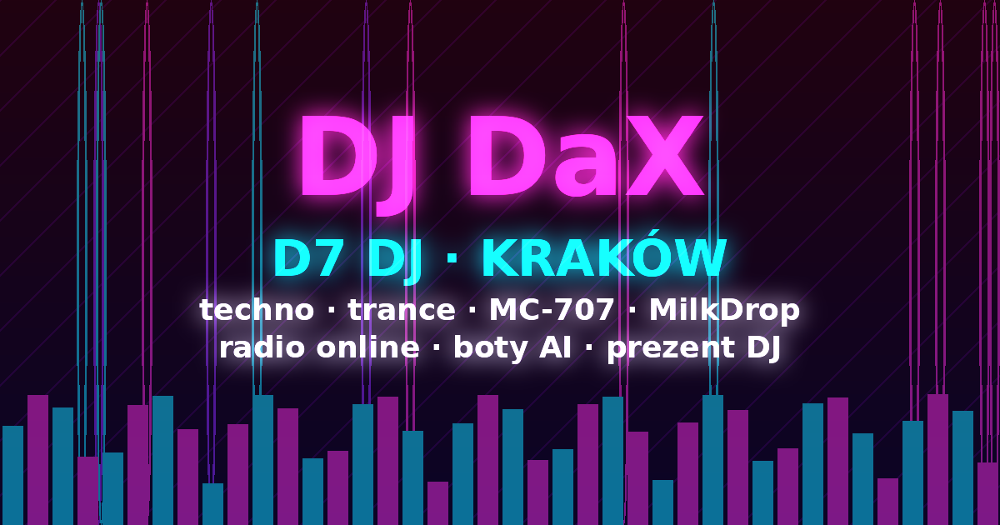

# 🎧 D7 DJ · DJ DaX · Kraków

**Darmowa aplikacja DJ w przeglądarce** — decki, Roland **MC-707** companion, **radio online** techno/trance, wizualizacje **MilkDrop**, boty AI. Autor: **DJ DaX (Daniel Dydo)**, Kraków.

| | |
|---|---|
| 🚀 Aplikacja | [app.html](https://danieldydo-cyber.github.io/d7-dj/app.html) |
| 🏠 Start | [https://danieldydo-cyber.github.io/d7-dj/](https://danieldydo-cyber.github.io/d7-dj/) |
| 🤖 Boty AI | [bots.html](https://danieldydo-cyber.github.io/d7-dj/bots.html) · [Fabryka 777 person](https://danieldydo-cyber.github.io/d7-dj/botfactory.html) |
| 📣 DJ na imprezy | [promo.html](https://danieldydo-cyber.github.io/d7-dj/promo.html) · [promo pack](https://danieldydo-cyber.github.io/d7-dj/promo-pack/) |
| 🎁 Prezent / voucher DJ | [prezent.html](https://danieldydo-cyber.github.io/d7-dj/prezent.html) |
| 💳 Wsparcie | [pay.html](https://danieldydo-cyber.github.io/d7-dj/pay.html) |
| 📱 APK | [download.html](https://danieldydo-cyber.github.io/d7-dj/download.html) |

**Tags:** DJ DaX Kraków · D7 DJ · MC-707 · techno · trance · radio online · MilkDrop · prezent DJ
